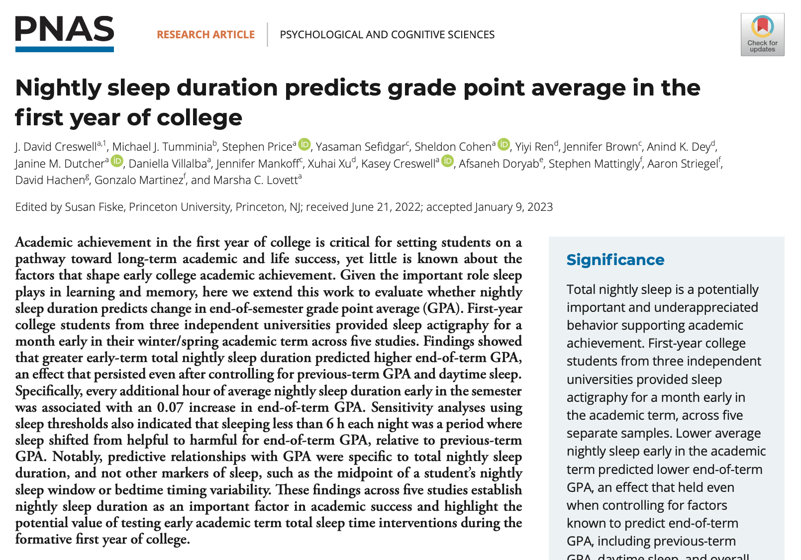

```{r init_setup, include=FALSE, cache=FALSE}
# Include setup
library(tidyverse)
library(ggfortify)
library(knitr)

knitr::opts_chunk$set(
  echo = FALSE, fig.align = "center"
)

hook_output <- knit_hooks$get("output")
knit_hooks$set(output = function(x, options) {
  lines <- options$output.lines
  if (is.null(lines)) {
    return(hook_output(x, options))  # pass to default hook
  }
  x <- unlist(strsplit(x, "\n"))
  more <- "..."
  if (length(lines) == 1) {        # first n lines
    if (length(x) > lines) {
      # truncate the output, but add ....
      x <- c(head(x, lines), more)
    }
  } else {
    x <- c(more, x[lines], more)
  }
  # paste these lines together
  x <- paste(c(x, ""), collapse = "\n")
  hook_output(x, options)
})
```

```{r, include=FALSE, cache=FALSE}
sleep = read.csv("week_09_docs/sleep.csv")
colleges = read.csv("week_09_docs/colleges.csv")
options(scipen = 999)
library(tidyverse)
library(tidymodels)

# Helper: draw a simple causal graph (nodes = named x/y positions, edges = from/to)
draw_dag = function(nodes, edges, highlight = NULL) {
  edges = edges |>
    left_join(nodes, by = c("from" = "name")) |> rename(x0 = x, y0 = y) |>
    left_join(nodes, by = c("to" = "name")) |> rename(x1 = x, y1 = y) |>
    mutate(dx = x1 - x0, dy = y1 - y0,
           # shrink each arrow so it starts/ends at the edge of the node boxes
           frac = 1.1 / pmax(abs(dx) / 0.38, abs(dy) / 0.17),
           xs = x0 + dx * frac, ys = y0 + dy * frac,
           xe = x1 - dx * frac, ye = y1 - dy * frac)
  ggplot() +
    geom_segment(data = edges, aes(x = xs, y = ys, xend = xe, yend = ye),
                 arrow = arrow(length = unit(0.35, "cm"), type = "closed"),
                 linewidth = 1.1, color = "grey30") +
    geom_label(data = nodes, aes(x = x, y = y, label = label, fill = role),
               size = 6, label.padding = unit(0.5, "lines"), color = "black") +
    scale_fill_manual(values = c(exposure = "#BF5700", outcome = "#F8971F",
                                 confounder = "#A6CD57", collider = "#9CADB7"),
                      guide = "none") +
    coord_cartesian(xlim = c(-0.6, 2.6), ylim = c(-0.4, 1.4)) +
    theme_void()
}
```

## Understanding vs predicting {.smaller}

- In a purely predictive model, we should include terms that reduce out-of-sample prediction error.\
- With lots of variables, many models will have essentially identical out-of-sample predictive error, and we can use any of them.\
- If we are trying to **understand** the relationships between a subset of the $X$ variables and $Y$, the model form is much more important.

## 



## Variables in the study {.smaller}

- `total_sleep_time` (TST): Average daily sleep time, recorded early in the term.\
- `cumulative_gpa`: GPA at the **beginning** of the term.\
- `midterm`: Midterm grade, recorded midway through the term.\
- `term_gpa`: GPA at the **end** of the term.\
- `study`: Four studies using different cohorts at different universities:
  - Study 2, 3: “large public university”\
  - Study 4: “private Catholic university”\
  - Study 5: “private, STEM-focused university”\
- `race`: 1 if either parent from an under-represented group (non-White/Asian).\
- `first_gen`: 1 if neither parent attended any college.\
- `gender`: 1 if reported male, 0 otherwise.\
- `height`: height in inches.

## Predicting term GPA from total sleep time {.smaller}

```{r, echo = TRUE}
model1 = lm(term_gpa ~ total_sleep_time, data=sleep)
summary(model1)
confint(model1)
```

## Confounder: which variable best suits this example? {.smaller}

- A confounder must **causally influence both** total sleep time (TST) and term GPA.
- Candidate in our data: `cumulative_gpa` (GPA at the **beginning** of the term).
  - It is measured *before* TST and before `term_gpa`, so neither of them can cause it.
  - Students with strong prior academic performance tend to be more disciplined (more regular sleep schedules, better time management) **and** tend to earn higher GPAs again.
  - Data check: it is strongly related to `term_gpa` and also correlated with TST.

```{r, echo = TRUE}
sleep |> 
  select(total_sleep_time, cumulative_gpa, term_gpa) |> 
  cor() |> round(2)
```

<!-- ## Cumulative GPA as a confounder -->

<!-- - Two paths link TST and term GPA: the **causal** path TST $\rightarrow$ GPA and the **backdoor** path TST $\leftarrow$ Cumulative GPA $\rightarrow$ GPA. -->

<!-- - Without adjusting, the backdoor path mixes into the TST coefficient. -->

## Term GPA from total sleep time, adjusting for the confounder {.smaller}

```{r, echo = TRUE}
model2 = lm(term_gpa ~ total_sleep_time + cumulative_gpa, data = sleep)
summary(model2)
```

## Cumulative GPA as a confounder

```{r, fig.width = 9, fig.height = 4.5}
nodes = tibble(
  name  = c("tst", "gpa", "cum"),
  label = c("Total sleep time", "Term GPA", "Cumulative GPA\n(confounder)"),
  x     = c(0, 2, 1),
  y     = c(0, 0, 1),
  role  = c("exposure", "outcome", "confounder")
)
edges = tibble(from = c("tst", "cum", "cum"), to = c("gpa", "tst", "gpa"))
draw_dag(nodes, edges)
```

## What did the confounder do?

- Once we adjust for cumulative GPA, the sleep coefficient shrinks by almost half: part of the original association came from the confounder, not from sleep.
- The remaining association is still positive and statistically significant.

## Building a model for understanding

- We would like to be able to conclude that more sleep **causes** higher GPAs, but this model will not let us do that.\
- We can rule out potential *confounders* by adding them to the model (along with other predictive variables) and avoid causal language.\
- **How do we decide which variables to include?**

## How do we decide which variables to include?

- Theory-driven, often “pre-registered” to avoid $p$-hacking.
- $p$-hacking: running statistical tests on a set of data until some statistically significant results arise.
- That can be done in a few different ways, for example: by stopping the collection of data once you get a $p$\<0.05, analyzing many outcomes, but only reporting those with $p$\<0.05, using covariates, excluding participants, etc.
- Data-driven, but be careful — we don’t want to overfit!

## Variables to always include

- **Confounders** are variables that **causally** influence both total sleep time and term GPA
  - Because of their **collinearity** with sleep time, the sleep time coefficient will be different if omitted from the model.\
  - To ensure we are measuring the effect of sleep and not the confounder, they must be in the model!
- Variables that are **strongly predictive** of term GPA and are (nearly) uncorrelated with total sleep time.
  - By reducing the residual standard error, these variables reduce the size of confidence intervals for the regression coefficient of interest.

## Variables you may want to include

- Variables that are **weakly predictive** of term GPA and (nearly) uncorrelated with total sleep time.
  - Is the more complex model worth the extra predictive power?
- Variables that someone might **think** are confounders, even if you don't agree (or they don't appear to be after seeing the data).
  - This lends your analysis some credibility.

## Variables you should NEVER include

- Variables that are **causally** influenced by the outcome $Y$ (term GPA).
  - These variables can introduce bias, especially if they're also causally influenced by total sleep time (a **collider**).\
  - This can happen by accident when constructing the final dataset (e.g., if we excluded students who dropped out at the end of the term).
- Variables that are **causally** influenced by the $X$ variable of interest (total sleep time).
  - Adjusting for these variables removes a part of the effect we're interested in!

## Report findings: {.smaller}

- Models with few or no other variables.\
- Models that adjust for theory-driven confounders and predictors.\
- Models that add data-driven confounders and predictors — specifically note these!\
- Models that add or remove subsets of potential confounders, to assess how **robust** the findings are.

## So, what did we find? {.smaller}

- After adjusting for cohort, cumulative GPA, and demographic variables, each additional hour of sleep is associated with an increase in predicted GPA of about **0.05 points**, with a 95% CI of about **\[0.03, 0.11\]**.\
- The effect estimate is robust to the specific adjustment for demographic variables hypothesized to correlate with sleep patterns and academic performance — this strengthens our argument!\
- In each case, our findings are statistically significant, and the estimated effects (and their plausible values based on the CIs) are all positive.\
- In other words, you should probably get more sleep!

## Example: a collider {.smaller}

- A **collider** is a variable that is **caused by both** the exposure and the outcome. Conditioning on it opens a spurious path between them.
- Is there a collider in our examples?
  - Sleep data: `cumulative_gpa` is a confounder (it is measured *before* sleep and term GPA), `race`, `gender`, `firstgen` and `study` are background characteristics. **None is caused by both TST and term GPA.**
  - Colleges data: SAT scores and acceptance rate are determined before students graduate, so graduation rate does not cause them.
- So we **create** one for the sleep data: `wellness_award`, equal to 1 if the student received a university "Healthy Habits & Honors" award, given to students with **good sleep habits and high end-of-term GPA**.

<!-- ## Creating the collider variable {.smaller} -->

```{r, echo = FALSE, output = FALSE}
set.seed(235)
sleep_c = na.omit(sleep)
z = function(x) as.numeric(scale(x))

# The award probability rises with BOTH sleep and term GPA
p_award = plogis(-1 + 1.2 * z(sleep_c$total_sleep_time) + 1.2 * z(sleep_c$term_gpa))
sleep_c$wellness_award = rbinom(nrow(sleep_c), 1, p_award)

write.csv(sleep_c, "week_09_docs/sleep_collider.csv", row.names = FALSE)
table(sleep_c$wellness_award)
```

## Causal graph: the award as a collider

```{r, fig.width = 9, fig.height = 4.5}
nodes = tibble(
  name  = c("tst", "gpa", "award"),
  label = c("Total sleep time", "Term GPA", "Wellness award\n(collider)"),
  x     = c(0, 2, 1),
  y     = c(1, 1, 0),
  role  = c("exposure", "outcome", "collider")
)
edges = tibble(from = c("tst", "tst", "gpa"), to = c("gpa", "award", "award"))
draw_dag(nodes, edges)
```

## Adjusting for a collider biases the estimate {.smaller}

```{r, echo = TRUE}
model6 = lm(term_gpa ~ total_sleep_time + wellness_award, data = sleep_c)
summary(model6)
```

## Adjusting for a collider biases the estimate {.smaller}

- Among students with the same award status, those who slept more must have had **lower** GPAs to earn the award (and vice versa), which cancels the true positive association.
- The estimate collapses toward zero and is no longer significant, even though sleep truly matters in this dataset.
- **Moral:** more variables is not always better. Never adjust for a variable that is an effect of both $X$ and $Y$.

## Multicollinearity {.smaller}

Multicollinearity exists whenever 2+ *predictors* in a regression model are moderately or highly correlated.

- If two predictors $X_1$ and $X_2$ are highly correlated, it is hard to estimate the effect of changing $X_1$ while keeping $X_2$ constant.\

- This means the coefficients for $X_1$ and $X_2$ could be misleading: we will get wide confidence intervals for $X_1$ and/or $X_2$, and the coefficients won't be stable (adding new data or predictors to the model could drastically change them).\

- That's a problem if we're using the size of a coefficient to understand the relationship between $X_1$ (or $X_2$) and $Y$.

- **Double counting:** when two predictors measure essentially the same thing (two scales, pounds and kilograms, math and verbal SAT as signs of general academic ability), the model splits one effect across both variables.

Correlation between the response and the predictors is good, but correlation between the predictors is not!

## Extreme examples

- Predicting your height based on the amount you weighed on one scale ($X_1$) and the amount you weighed on a second scale ($X_2$): very hard to disentangle the effects of $X_1$ and $X_2$.\
- Predicting your height based on your weight in pounds ($X_1$) and your weight in kilograms ($X_2$): perfect multicollinearity — impossible to disentangle the effects of $X_1$ vs $X_2$.

## Math SAT predicts graduation rate above and beyond acceptance rate {.smaller}

```{r, echo = TRUE}
model3 = lm(Graduation.rate ~ Average.math.SAT + Acceptance.rate, data = colleges)
summary(model3)
```

## But not after adding verbal SAT {.smaller}

```{r, echo = TRUE}
model4 = lm(Graduation.rate ~ Average.math.SAT + Average.verbal.SAT + Acceptance.rate, data = colleges)
summary(model4)
```

## Dealing with multicollinearity {.smaller}

There are two general strategies for dealing with **multicollinearity**:

- Drop one of the highly correlated variables and rerun. (Just like we drop one of the dummy variables when putting a categorical variable in the model!)\
- Combine the variables that correlate into a composite variable. (Combined SAT score = Math + Verbal)
- When we combine math and verbal SAT into a single variable, we no longer count the same information twice, and the coefficients are stable.

## Dealing with multicollinearity {.smaller}

```{r, echo = TRUE}
model5 = lm(Graduation.rate ~ Average.combined.SAT + Acceptance.rate, data = colleges)
summary(model5)
```

## When is multicollinearity not a problem?

- When there is high collinearity in $X$'s that are strictly for adjustment, not interpretation, and the coefficient we want to interpret corresponds to a variable with low multicollinearity.\
- When multicollinearity comes from how we construct $X$: e.g., adding polynomial terms (like last week!), turning categories into dummy variables, or adding interactions.\
- When we are just trying to predict using relatively few $X$'s, and only predicting at *“typical”* $X$ values.
