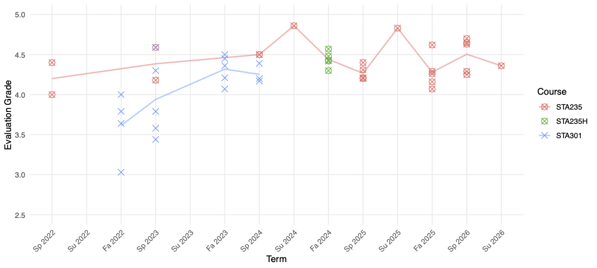
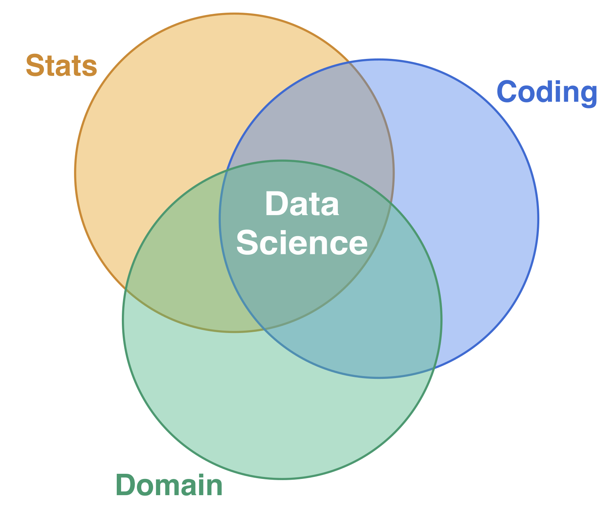
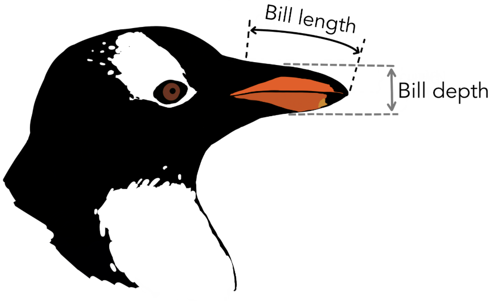
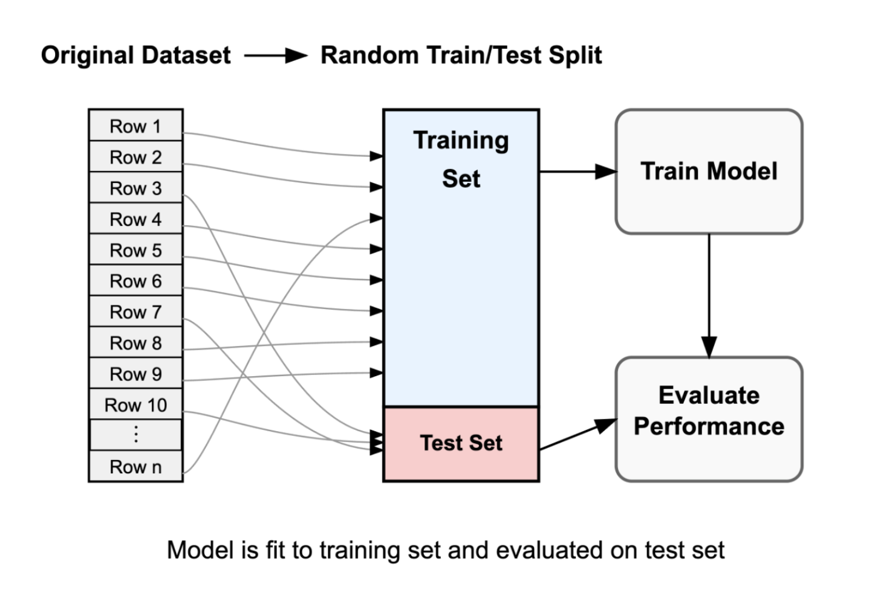
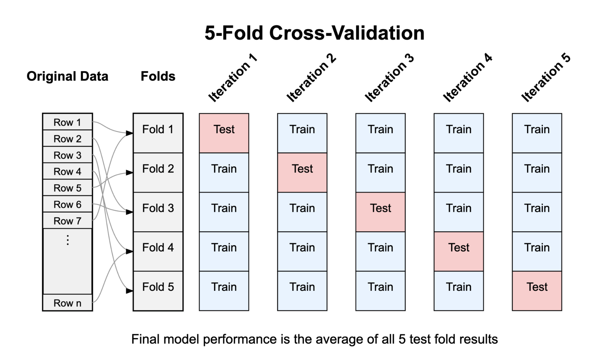

```{r init_setup, include=FALSE, cache=FALSE}
# Include setup
library(knitr)

knitr::opts_chunk$set(
  echo = FALSE, fig.align = "center"
)

hook_output <- knit_hooks$get("output")
knit_hooks$set(output = function(x, options) {
  lines <- options$output.lines
  if (is.null(lines)) {
    return(hook_output(x, options))  # pass to default hook
  }
  x <- unlist(strsplit(x, "\n"))
  more <- "..."
  if (length(lines) == 1) {        # first n lines
    if (length(x) > lines) {
      # truncate the output, but add ....
      x <- c(head(x, lines), more)
    }
  } else {
    x <- c(more, x[lines], more)
  }
  # paste these lines together
  x <- paste(c(x, ""), collapse = "\n")
  hook_output(x, options)
})
```

```{r, include=FALSE, cache=FALSE}
# sleep = read.csv("week_12_docs/sleep.csv")
# colleges = read.csv("week_12_docs/colleges.csv")
# options(scipen = 999)
```

# About me

## Henrique Bolfarine {.smaller}

:::::: columns
::: {.column width="35%"}

:::

::: {.column width="5%"}
:::

::: {.column width="60%"}
- Doctor in Statistics/ University of São Paulo
- email: [henrique.bolfarine\@austin.utexas.edu](henrique.bolfarine@austin.utexas.edu)
- website: [hbolfarine.github.io](https://hbolfarine.github.io)
- Link with [CV](https://hbolfarine.github.io/Henrique_Bolfarine_s_CV.pdf)
- Curious fact about me: I was born in the U.S. while my father was doing his Ph.D. in statistics at Berkeley.
:::
::::::

## About me

[**Teaching:**]{style="color: #bf5700;"} I served as a Lecturer in Statistics at the [McCombs School of Business at UT Austin]{style="color: #bf5700;"} from spring 2022 to fall 2026. Previously, I taught at the University of São Paulo, where I completed my doctorate under Prof. Hedibert F. Lopes (Duke alumni and former University of Chicago professor).\
\

[**Post-Doc:**]{style="color: #bf5700;"} I served as a Visiting Researcher at the McCombs School of Business at UT Austin from the spring to the fall of 2021 under Prof. Carlos M. Carvalho.

## About me

[**Research:**]{style="color: #bf5700;"} I still try to keep up with the most recent statistical methodology. Recently, I have focused on model interpretability in complex statistical methods.\

::: {style="font-size: 0.7em;"}
- “Lower-dimensional posterior density and cluster summaries for overparameterized Bayesian models”, (H. Bolfarine, H.F. Lopes, & C.M. Carvalho). [*Statistics and Computing*]{style="color: #bf5700;"}, 2026

- “Decoupling Shrinkage and Selection in Gaussian Linear Factor Analysis”, (H. Bolfarine, C. M. Carvalho, H. F. Lopes & J. S. Murray), [*Bayesian Analysis*]{style="color: #bf5700;"}, 2024

- 2021 International Statistical Institute Mahalanobis Award: A Tribute to Heleno Bolfarine.” (F. Ruggeri, H.Bolfarine, J. L. Bazán, R. B. Arellano-Valle, V. H. L. Davila, M. de Castro). [*International Statistical Review*]{style="color: #bf5700;"}, 2021
:::

## About me

[**Personally:**]{style="color: #bf5700;"} I have a wife and a 10-year-old daughter. The next step is adopting a puppy, though this part is still under negotiation.

{fig-align="center" width="55%"}

# Teaching

## McCombs School of Business

- [**STA 301**]{style="color: #bf5700;"} - Introduction to Data Science
- [**STA 235**]{style="color: #bf5700;"} - Data Science for Business Applications
  - Core classes - Quantitative Reasoning
  - Including this semester, so far I have taught 51 sections
  - Each section has around 60–65 students
  - This semester, I have 300 students enrolled across my five sections alone

## Evaluation Grade

{fig-align="center" width="40%"}

##  {.center}

::: {style="text-align: center; font-size: 1.5em;"}
"When a measure becomes a target, it ceases to be a good measure."
:::

Goodhart's law

## [STA 301]{style="color: #bf5700;"} - Introduction to Data Science

- Standardized course across all sections
- Intro to R/RStudio
- Data wrangling/data exploration (`tidyverse`)
- Introduction to inference using bootstrapping
- Statistical modeling: linear regression

<!-- Textbook: *Data Science in R: A Gentle Introduction* -->

Textbook: [*Data Science in R: A Gentle Introduction*](https://bookdown.org/jgscott/DSGI/)

## [STA 301]{style="color: #bf5700;"} list of topics

::::::: {style="font-size: 1em;"}
:::::: columns
::: {.column width="48%"}
- Understanding your Data
- Summaries and Plots
- Counting and probability
- Data Wrangling
- Linear models
- The bootstrap
:::

::: {.column width="2%"}
:::

::: {.column width="48%"}
- P-values
- Large-sample inference
- Experiments and observational studies
- Linear regression
- Predictive models
- Probability models
:::
::::::
:::::::

## Observations on [STA 301]{style="color: #bf5700;"}

- Really well-defined material
  - Work with the material; don't fight it
  - [Live coding]{style="color: #bf5700;"} was a really important step in the process
- Emergence of LLMs in spring 2023
  - First noticed a student [using an LLM]{style="color: #bf5700;"} (ChatGPT) while proctoring an exam
  - Open notes until then, with exams using Canvas and RStudio
  - Recently, exams were [moved to paper]{style="color: #bf5700;"}

## [STA 235]{style="color: #bf5700;"} - Data Science for Business Applications

- Upper level statistics course
- Focused basically in Regression Models and Applications

:::::: {style="font-size: 0.7em;"}
::::: columns
::: {.column width="50%"}
- Simple & Multiple Regression
- Categorical variables & interactions
- Diagnostics
- Non-linear transformations
- Time Series
:::

::: {.column width="50%"}
- Logistic Regression
- Decision Trees/ Random Forest
- Model Selection
- Randomized Control Trial
- Natural Esxperiments
:::
:::::
::::::

## [STA 235]{style="color: #bf5700;"} - Data Science for Business Applications

- First class that I taught at UT (spring 2022)
- One of the first [in-person]{style="color: #bf5700;"}, post-pandemic classes at McCombs
- Not necessarily a standardized course
- Participated actively in curriculum development
- Almost like a lab for new ideas
- I also teach the [online section]{style="color: #bf5700;"} for this class

## Observations on [STA 235]{style="color: #bf5700;"}

- Many strategies were tested: Lockdown, WebR, Posit
- Move from coding to understanding
- Code is still covered in class, though with less emphasis
- Transition to paper assignments, exams and quizzes
- Other sections are moving from exams to [oral presentations]{style="color: #bf5700;"}
- [LLM tools]{style="color: #bf5700;"} are being used to create study material
  - [Claude Practice Room](https://claude.ai/artifact/2fX9TcNeU6mQY7wpyZhxWZ)

## What I've learned so far

- Emphasize that Statistics and Data Science is about [answering questions]{style="color: #bf5700;"} with [data as evidence]{style="color: #bf5700;"}
- Coding is important:
  - Helps with [logical steps]{style="color: #bf5700;"} connecting to statistical concepts
  - [Self-sufficiency]{style="color: #bf5700;"} : *"I didn't know what programming was before 301. After I took it, I did."*
  - A large number of students still [follow along]{style="color: #bf5700;"} with live coding
  - `tidyverse` creates standards

## Should we pivot to the use of LLMs?

There are [several issues]{style="color: #bf5700;"} that might come into place

- No clear guidelines
- Constantly [changing environment]{style="color: #bf5700;"}
  - Prompt engineering / vibe coding / agents / RAGs / MCPs / skills
- Uneven [code quality]{style="color: #bf5700;"} across students
- Data security and cost

## LLM adoption

- Coding tools are interesting (Claude code)
- [Self-sufficiency]{style="color: #bf5700;"} is still necessary
- Focus on interpreting models and results

# Lecture

## Goal of this lecture

- [Compare classification models]{style="color: #bf5700;"} using cross-validation
- Present complex topics in an easily understandable way
- Connect concepts with my research interests
- Apply a [hands-on]{style="color: #bf5700;"} approach

## Elements of Data Science

\

::::::: {style="font-size: 0.9em;"}
:::::: columns
::: {.column width="50%"}
[**Based on SDS 322E**]{style="color: #bf5700;"}

- Data wrangling
- Simulation-based inference
- Classification
  - Logistic regression
  - Decision trees
  - Random forests
  - [**Tabular foundation models**]{style="color: #bf5700;"}
:::

::: {.column width="1%"}
:::

::: {.column width="49%"}
{width="110%"}
:::
::::::
:::::::

## Objectives

- Select models that [predict well]{style="color: #bf5700;"} on out-of-sample data
- [Model assessment]{style="color: #bf5700;"}, not model selection
- Compare different models in a fair way
- Start with a single [train/test split]{style="color: #bf5700;"}
- Introduce the [$k$-fold cross-validation]{style="color: #bf5700;"} procedure.
- We'll do this first without the use of `tidymodels`

## Today's question

- Which model better [predicts]{style="color: #bf5700;"} male vs. female penguins from a pre-defined set of variables?

- For this task, we are evaluating four models:

  - Logistic Regression
  - Decision trees
  - Random forests
  - Tabular foundation models

Naive approach - [no fine tuning]{style="color: #bf5700;"}

## Classification Models {.smaller}

::: {#tbl-model-comparison tbl-cap-location="bottom" style="font-size: 0.7em;"}
| Criterion | Logistic regression | Decision trees | Random forests | Tabular foundation models |
|:--------------|:-------------:|:-------------:|:-------------:|:-------------:|
| Captures non-linearity | ❌ | ✅ | ✅ | ✅ |
| Feature interactions | ❌ | ✅ | ✅ | ✅ |
| Interpretability | ✅ | 🟡 | 🟡 | ❌ |
| Predictive accuracy | 🟡 | 🟡 | ✅ | ✅ |
| Scales to large datasets | ✅ | ✅ | ✅ | ❌ |
| Training speed | ✅ | ✅ | 🟡 | ✅ |
| Inference speed | ✅ | ✅ | ✅ | 🟡 |
| Little hyperparameter tuning needed | ✅ | 🟡 | 🟡 | ✅ |
| Little preprocessing needed | ❌ | ✅ | ✅ | ✅ |
| Low compute requirements | ✅ | ✅ | 🟡 | ❌ |

: Comparison of the different models (✅ Good, 🟡 So-so, ❌ Bad)

Source: [Tree-based methods](https://bgreenwell.github.io/treebook/) and [Tabular Foundation Models: First Look](https://tabularfoundationmodels.com/first-look).
:::

## Palmer Penguins

::::::: {style="font-size: 0.75em;"}
::::: columns
::: {.column width="40%"}
- The `penguins` data set contains **333 penguins** of different species (Palmer antarctic station). <!-- **Variables** -->

- `bill_length_mm`: culmen (upper ridge of the beak) length, in mm

- `bill_depth_mm`: culmen depth, in mm

- `sex`: dummy variable, **1 = male**, **0 = female**
:::

::: {.column width="60%"}
{fig-align="center" width="8.3in" height="4in"}
:::
:::::

::: {style="font-size: 0.8em; text-align: center;"}
Source: <https://allisonhorst.github.io/palmerpenguins/>
:::
:::::::

## Palmer Penguins

```{r, echo=FALSE, fig.width=5, fig.height=3.5, out.width="80%", fig.align="center"}
library(tidyverse)
penguins = read.csv("week_10_docs/peguin.csv")

ggplot(penguins, aes(x = bill_depth_mm, y = bill_length_mm, col = factor(sex))) +
  geom_point(size = 2, alpha = 0.8) +
  scale_color_discrete(labels = c("0" = "0 - female", "1" = "1 - male")) +
  labs(x = "Bill depth (mm)", y = "Bill length (mm)", col = "Sex") +
  theme_minimal(base_size = 14) +
  theme(legend.position = "bottom")
```

## Details on the Analysis

- To keep the [analysis fair]{style="color: #bf5700;"}:
  - Use the same train/test split
  - Use the same cross-validation folds for all models
- Compare the models based on their cross-validation results and [choose one]{style="color: #bf5700;"}.

## Training/test splits in general {.smaller}

\

:::::: columns
::: {.column width="70%"}

:::

:::: {.column width="30%"}
::: incremental
- [Randomly]{style="color: #bf5700;"} allocating observations makes train/test sets representative of the full data set
- [80/20% train/test]{style="color: #bf5700;"} splits are common
- More testing data $\to$ More accurate estimates of prediction error
- More training data $\to$ Better representation of full-data fit
:::
::::
::::::

## Creating a train/test split {.smaller}

Let’s do the same thing for the `penguins` data, but by randomly splitting the data into a training and test set

```{r}
library(reticulate) # Load functions from python
# Must run before Python is initialized (restart R if you already ran Python code)
if (virtualenv_exists("r-tabicl")) {
  use_virtualenv("r-tabicl", required = TRUE)
} else {
  py_require("tabicl")
}
```

```{r, echo = TRUE}
library(rpart) # Decsion Trees
library(randomForest) # Random Forest
library(reticulate) # Load Python libraries
set.seed(1234)

# Number of samples
n = nrow(penguins)

# Indexes created from 80% of the original data
idx = sample(n, 0.8*n)

# Create a 80% training and 20% testing split 
X_train = penguins[idx, ]
X_test = penguins[-idx, ]

# Response variable from the original split
y_train <- X_train$sex
y_test  <- X_test$sex
```

- The `set.seed(1234)` command ensures [reproducible]{style="color: #bf5700;"} “random” splits.

## Train the models {.smaller}

- Models are fitted without fine-tuning ([out of the box]{style="color: #bf5700;"})
  - **Logistic Regression** / **Decision Trees** / **Random Forest**

```{r, echo = TRUE}
# Logistic Regression Model
fit_logistic <- glm(sex ~ bill_length_mm + bill_depth_mm,
                    data = X_train, family = "binomial")

# Decision Tree Model
fit_tree <- rpart(as.factor(sex) ~ bill_length_mm + bill_depth_mm,
                  data = X_train, method = "class")

# Random Forest
fit_forest <- randomForest(as.factor(sex) ~ bill_length_mm + bill_depth_mm,
                           data = X_train, ntree = 500)
```

- **TabICL** model

```{r, echo = TRUE}
py_require("tabicl")
features <- c("bill_length_mm", "bill_depth_mm")

# Import tabicl python function
tabicl <- import("tabicl")

clf <- tabicl$TabICLClassifier()
clf$fit(as.matrix(X_train[, features]), as.character(y_train))
```

## Generate predictions {.smaller}

- Get their predictions on the test set:

```{r, echo = TRUE}
# Prediction using logistic regression using 0.5 threshold
pred_logistic <- ifelse(predict(fit_logistic, newdata = X_test,
                                type = "response") >= 0.5, 1, 0)
 
# Prediction using decision trees
pred_tree <- predict(fit_tree, newdata = X_test, type = "class")

# Prediction using random forest
pred_forest <- predict(fit_forest, newdata = X_test)

# Prediction for TabICL
pred_tabicl <- clf$predict(as.matrix(X_test[, features]))
```

- Performance is defined by

::: {style="text-align: center; font-size: 1.5em;"}
Accuracy = $\frac{\text{TP + TN}}{\text{Total}}$
:::

Here, $\text{TP}$ is the number of [true positives]{style="color: #bf5700;"}, $\text{TN}$ is the number of [true negatives]{style="color: #bf5700;"}, and $\text{Total}$ is the size of the data set.

## Measuring performance {.smaller}

- We can easily calculate the accuracy simply by matching the 1s and 0s of the predicted and actual values.

```{r, echo = TRUE}
# Accuracy of the logistic regression
mean(pred_logistic == y_test)

# Accuracy of the decision trees
mean(as.character(pred_tree) == as.character(y_test))

# Accuracy of the Random Forest model
mean(as.character(pred_forest) == as.character(y_test))

# Accuracy of the TabICL model
mean(pred_tabicl == as.character(y_test))
```

## Measuring performance

| Model               | Accuracy (Single Train/Test Split) |
|:--------------------|:----------------------------------:|
| Logistic regression |                0.75                |
| **Decision trees**  |              **0.84**              |
| Random forest       |                0.75                |
| TabICL              |                0.78                |

Can we conclude that the Decision Trees is the [best model]{style="color: #bf5700;"} in making predictions?

## What is the problem with this approach?

\

- We might get [unlucky]{style="color: #bf5700;"} in our train/test split.
- How can we solve this problem?

## $k$-fold Cross-Validation

::: center

:::

## Example with $k$ = 3 {.smaller}

First we need to split the data into $k = 3$ random groups/folds of roughly the same size

```{r, echo = TRUE}
# Number of folds
k = 3

# Assign each row to a fold 
folds <- sample(rep(1:k, length.out = n))

# Split the data into the 3 folds
fold1 <- penguins[folds == 1, ]
fold2 <- penguins[folds == 2, ]
fold3 <- penguins[folds == 3, ]
```

Now we need to run the model 3 times:

- Model A: test on `fold1`, train on `fold2` and `fold3`
- Model B: test on `fold2`, train on `fold1` and `fold3`
- Model C: test on `fold3`, train on `fold1` and `fold2`

## Building the models {.smaller}

- We'll focus on the **logistic regression model** first

```{r, echo = TRUE}
# fold1 predicted by fold2 and fold3
modelA.l <- glm(sex ~ bill_length_mm + bill_depth_mm,
             data = rbind(fold2, fold3), family = "binomial")

# fold2 predicted by fold1 and fold3
modelB.l <- glm(sex ~ bill_length_mm + bill_depth_mm,
             data = rbind(fold1, fold3), family = "binomial")

# fold3 predicted by fold1 and fold2
modelC.l <- glm(sex ~ bill_length_mm + bill_depth_mm,
             data = rbind(fold1, fold2), family = "binomial")
```

- Getting the predictions

```{r, echo = TRUE}
pred_model_A <- ifelse(predict(modelA.l, newdata = fold1,
                                type = "response") >= 0.5, 1, 0)
pred_model_B <- ifelse(predict(modelB.l, newdata = fold2,
                               type = "response") >= 0.5, 1, 0)
pred_model_C <- ifelse(predict(modelC.l, newdata = fold3,
                               type = "response") >= 0.5, 1, 0)
```

## Calculating the Accuracy {.smaller}

For each model we get three different Accuracy estimates:

```{r, echo = TRUE}
mean(pred_model_A == fold1$sex)
mean(pred_model_B == fold2$sex)
mean(pred_model_C == fold3$sex)
```

Our final estimate of accuracy is the average of these three estimates:\

::: {style="text-align: center; font-size: 1.5em;"}
Accuracy$_{\text{CV}}$ = $\frac{0.74 + 0.79 + 0.83}{3} \approx 0.79$
:::

We'll do the same for the other methods

## CV for Decision trees {.smaller}

```{r, echo = TRUE}
modelA.t <- rpart(as.factor(sex) ~ bill_length_mm + bill_depth_mm,
                  data = rbind(fold2, fold3), method = "class")
modelB.t <- rpart(as.factor(sex) ~ bill_length_mm + bill_depth_mm,
                  data = rbind(fold1, fold3), method = "class")
modelC.t <- rpart(as.factor(sex) ~ bill_length_mm + bill_depth_mm,
                  data = rbind(fold1, fold2), method = "class")

pred_model_A.t <- predict(fit_tree, newdata = fold1, type = "class")
pred_model_B.t <- predict(fit_tree, newdata = fold2, type = "class")
pred_model_C.t <- predict(fit_tree, newdata = fold3, type = "class")

mean(as.character(pred_model_A.t) == as.character(fold1$sex))
mean(as.character(pred_model_B.t) == as.character(fold2$sex))
mean(as.character(pred_model_C.t) == as.character(fold3$sex))
```

::: {style="text-align: center; font-size: 1.5em;"}
Accuracy$_{\text{CV}}$ = $\frac{0.84 + 0.87 + 0.86}{3} \approx 0.86$
:::

## CV for Random forests {.smaller}

```{r, echo = TRUE}
modelA.f <- randomForest(as.factor(sex) ~ bill_length_mm + bill_depth_mm,
                           data = rbind(fold2, fold3), ntree = 500)
modelB.f <- randomForest(as.factor(sex) ~ bill_length_mm + bill_depth_mm,
                           data = rbind(fold1, fold3), ntree = 500)
modelC.f <- randomForest(as.factor(sex) ~ bill_length_mm + bill_depth_mm,
                           data = rbind(fold1, fold2), ntree = 500)

pred_model_A.f <- predict(fit_forest, newdata = fold1)
pred_model_B.f <- predict(fit_forest, newdata = fold2)
pred_model_C.f <- predict(fit_forest, newdata = fold3)

mean(as.character(pred_model_A.f) == as.character(fold1$sex))
mean(as.character(pred_model_B.f) == as.character(fold2$sex))
mean(as.character(pred_model_C.f) == as.character(fold3$sex))
```

::: {style="text-align: center; font-size: 1.5em;"}
Accuracy$_{\text{CV}}$ = $\frac{0.96 + 0.96 + 0.92}{3} \approx 0.95$
:::

## CV for TAbICL {.smaller}

```{r, echo = TRUE}
# Set the classifiers
clf.A <- tabicl$TabICLClassifier()
clf.B <- tabicl$TabICLClassifier()
clf.C <- tabicl$TabICLClassifier()

# invisible - hides the messages from the prediction function
invisible(clf.A$fit(as.matrix(rbind(fold2, fold3)[, features]), as.character(rbind(fold2, fold3)[, 'sex'])))
invisible(clf.B$fit(as.matrix(rbind(fold1, fold3)[, features]), as.character(rbind(fold1, fold3)[, 'sex'])))
invisible(clf.C$fit(as.matrix(rbind(fold1, fold2)[, features]), as.character(rbind(fold1, fold2)[, 'sex'])))

# Prediction for each classfier
pred_tabicl.A <- clf.A$predict(as.matrix(fold1[, features]))
pred_tabicl.B <- clf.B$predict(as.matrix(fold2[, features]))
pred_tabicl.C <- clf.C$predict(as.matrix(fold3[, features]))
```

Measuring the out of sample accuracy

```{r, echo = TRUE}
mean(as.character(pred_tabicl.A) == as.character(fold1$sex))
mean(as.character(pred_tabicl.B) == as.character(fold2$sex))
mean(as.character(pred_tabicl.C) == as.character(fold3$sex))
```

::: {style="text-align: center; font-size: 1.2em;"}
Accuracy$_{\text{CV}}$ = $\frac{0.77 + 0.87 + 0.86}{3} \approx 0.83$
:::

## Re-doing our model comparisons {.smaller}

| Model | Accuracy (all data) | Accuracy (Single Train/Test Split) | Accuracy (3 Fold CV) |
|------------------|:----------------:|:----------------:|:-----------------:|
| Logistic regression | 0.78 | 0.75 | 0.79 |
| Decision trees | 0.86 | 0.84 | 0.86 |
| **Random forest** | 0.99 | 0.75 | **0.95** |
| TabICL | \- | 0.78 | 0.83 |

- A single split doesn't show the complete picture
- Logistic regression can be improved by adding non-linear features
- Decision trees work surprisingly well on this data
- Random forest is based on a resampling procedure - (in-sample/CV difference)
- By design, TabICL can't be evaluated on in-sample data

## Take away

- More folds give a better estimate of the out-of-sample error
  - The [variance of the estimator]{style="color: #bf5700;"} can go up!
- [*Leave-one-out cross-validation*]{style="color: #bf5700;"}: $k$ is equal to the sample size
  - Can be expensive to run
  - Overlapping observations (the training sets are nearly identical)
- Typically, $k = 5$ or $k = 10$ has been empirically shown to be a good choice

## Isn’t there a faster way? {.smaller}

In practice, you don’t have to do this all manually! The `tidymodels` package makes it easy to do [cross-validation]{style="color: #bf5700;"} even for larger $k$.

```{r echo=TRUE}
library(tidymodels)

# Randomly split the data into 5 folds
folds <- vfold_cv(penguins, v=5)

# Build a tidymodels "workflow" for a logistic regression
workflow() |> 
  add_model(logistic_reg()) |> 
  add_formula(as.factor(sex) ~ bill_length_mm + bill_depth_mm) %>%
  fit_resamples(folds, metrics = metric_set(accuracy)) %>%
  collect_metrics()
```

Accuracy of the logistic regression model is 0.77 using $k = 5$ folds.

<!-- ```{r} -->

<!-- # ---- Logistic regression ---------------------------------------------------- -->

<!-- fit_logistic <- glm(sex ~ bill_length_mm + bill_depth_mm, -->

<!--                     data = penguins, family = "binomial") -->

<!-- # summary(fit_logistic) -->

<!-- pred_logistic <- ifelse(predict(fit_logistic, newdata = penguins, -->

<!--                                 type = "response") >= 0.5, 1, 0) -->

<!-- mean(pred_logistic == penguins$sex) -->

<!-- # ---- Decision tree ---------------------------------------------------------- -->

<!-- fit_tree <- rpart(factor(sex) ~ bill_length_mm + bill_depth_mm, -->

<!--                   data = penguins, method = "class") -->

<!-- pred_tree <- predict(fit_tree, newdata = penguins, type = "class") -->

<!-- mean(as.character(pred_tree) == as.character(penguins$sex)) -->

<!-- # plot tree -->

<!-- # ---- Random forest ---------------------------------------------------------- -->

<!-- fit_forest <- randomForest(as.factor(penguins$sex) ~ bill_length_mm + bill_depth_mm, -->

<!--                            data = penguins, ntree = 500) -->

<!-- pred_forest <- predict(fit_forest, newdata = penguins) -->

<!-- mean(as.character(pred_forest) == as.character(penguins$sex)) -->

<!-- ``` -->
